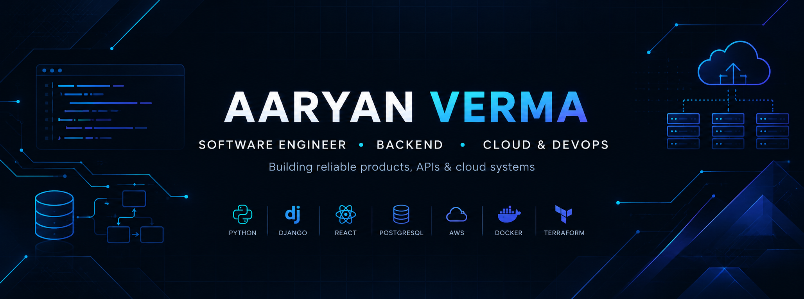

### Software Developer · Backend Engineer · Full Stack Developer · Cloud & DevOps

Building reliable APIs, practical products, and cloud-deployed applications.

---

## 👋 About Me

Hi, I'm **Aaryan Verma**, a B.Tech Computer Science student at **SIRT, Bhopal (Class of 2027)**. I enjoy building backend-first applications, designing REST APIs, working with databases, and deploying applications using AWS and container tools.

- 🎓 **Education:** B.Tech CSE, SIRT Bhopal — CGPA **8.38/10**
- 💻 **Problem solving:** 350+ LeetCode problems solved
- 🧩 **Focus areas:** Software Engineering, Backend Development, Full Stack Development, Cloud & DevOps
- ☁️ **Cloud / DevOps:** AWS, Docker, Docker Compose, Terraform, Linux, CI/CD fundamentals
- 🤖 **AI projects:** Generative AI, multilingual content workflows, and AI-assisted applications
- 🤝 **Community:** Head Coordinator of the college Coding Club; social-work volunteering through True Sage Foundation

I like turning ideas into useful software, learning by building, and understanding how applications run beyond the local development environment.

## 🛠️ Tech Stack

### Languages

### Backend & Frontend

### Databases

### Cloud & DevOps

### AI / GenAI

## 🚀 Featured Projects

### 1. EVE Healthcare — Diagnostic Booking Platform
A diagnostic appointment platform with JWT authentication, role-based access, clinic-level tenant isolation, diagnostic test management, and appointment scheduling.

**Tech:** Django REST Framework · PostgreSQL · Docker · Docker Compose · AWS ECR · ECS · Application Load Balancer

[View Repository](https://github.com/aaryan417/EVE-Healthcare-diagnostic-booking)

### 2. Bhasha Setu — Multilingual AI Content Studio
An AI-powered content workflow designed to help create and adapt content for multiple Indian languages and social platforms. Features include content generation, video scripts, hashtags, voice/TTS workflows, and content planning.

**Tech:** Amazon Bedrock Nova Lite · IndicTrans2 · Amazon Polly · AWS EC2 · API Gateway

[Browse my repositories](https://github.com/aaryan417?tab=repositories) · *Direct repository and live-demo links to be added after verification.*

### 3. SafeSphere AI — Disaster Preparedness
An AI-assisted disaster preparedness concept combining emergency alerts, SOS workflows, map-based information, multilingual assistance, and immersive preparedness content.

[Browse my repositories](https://github.com/aaryan417?tab=repositories) · *Direct repository and live-demo links to be added after verification.*

### 4. Orbin — Event Management & Certificate Automation
An event-management platform covering event creation, registrations, role-based access, QR-based check-in, certificate generation, and bulk spreadsheet processing.

**Tech:** Django REST Framework · FastAPI · Excel processing · PDF generation · Email automation

### 5. ResolveAI — Ticket Management Platform
A ticket-management application built with a Django backend and React frontend, designed around structured ticket workflows and a dashboard experience.

**Tech:** Django · React · REST APIs

> **More projects:** [Explore all repositories on GitHub](https://github.com/aaryan417?tab=repositories). Project-specific links and live demos will be added once verified.

## 🏆 Achievements & Research

- 🥇 **Anveshna Hackathon** — National-level 1st place
- 🥉 **AI Innovation Challenge 2026**, Sage University, Bhopal — 3rd place
- 🥇 **Smart India Hackathon (internal round)** — 1st place
- 🥉 **RICR Moving Metro Agritech** — 3rd place
- 📄 **INCIP 2026:** Presented research on the empirical evaluation of energy and carbon costs across programming languages and ML model optimizations
- 🧠 Solved **350+ LeetCode problems** (self-reported)

## 💼 Experience & Leadership

**Coding Arena — Intern** · April 2026 – July 2026  
Worked on full-stack project development, including event-management workflows, REST APIs, authentication, database-backed features, e-commerce functionality, and automation.  
*Project work included Orbin Event Management and DermaCart.*

**College Coding Club — Head Coordinator**  
Helped coordinate club activities, events, and technical seminars.

**True Sage Foundation — Volunteer**  
Contributed to teaching and educational support for children in underserved communities.

## 🎓 Education

**B.Tech in Computer Science & Engineering**  
SIRT, Bhopal · Expected 2027 · **CGPA: 8.38/10**

**Class XII** — Government Higher Secondary School, Juwadi · 2023 · **85.60%**  
**Class X** — Government High School, Ranipur · 2021 · **88%**

## 📊 GitHub Snapshot

## 🤝 Let's Connect

I'm interested in opportunities across **Software Development, Backend Engineering, Full Stack Development, and Cloud / DevOps**.

- **GitHub:** [@aaryan417](https://github.com/aaryan417)
- **LinkedIn:** [Aaryan Verma](https://linkedin.com/in/aaryan-verma-bb340530b/)
- **Email:** [aaryanverma751@gmail.com](mailto:aaryanverma751@gmail.com)

*Thanks for visiting my profile! Always building, learning, and improving.*

